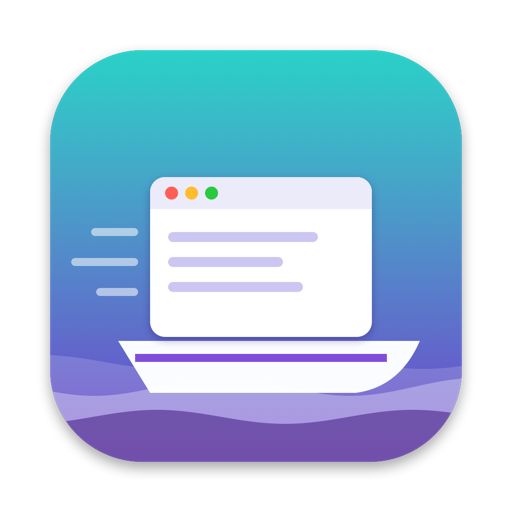
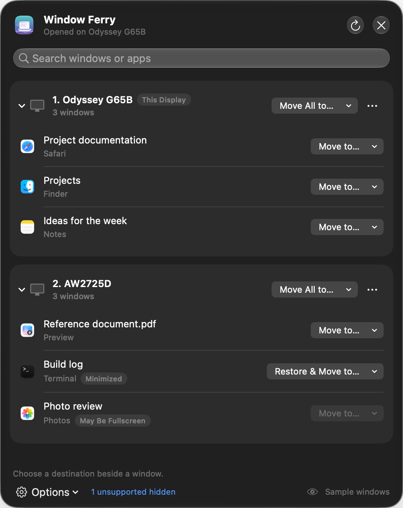

<p align="center"></p>

<h1 align="center">Window Ferry</h1>

A free, native macOS menu-bar utility for moving windows between displays — including
from a monitor you can't currently see (for example, one switched to another input
while macOS still treats it as connected).

SwiftUI + AppKit, public Accessibility APIs only, no dependencies, MIT license.



## Features

- **Move to…** beside every window and **Move All to…** per display, in either direction. Apps don't need focus.
- Instant search across window titles and app names.
- **Mark as Unavailable** on a display: new windows that appear there are routed to an available display (best effort). Existing windows stay until you move them.
- Global shortcuts (defaults below) to move the focused window to the previous/next display or the display under the pointer.
- Minimized windows can be restored and moved explicitly; fullscreen-like windows are detected and skipped.
- A floating Liquid Glass panel on macOS 26 and later, with a translucent material fallback on macOS 13–15.
- No network access, analytics, accounts, or private APIs.

## Requirements

macOS 13 or later. Building needs Xcode or the Command Line Tools with Swift 5.9+.

## Build and run

```sh
git clone https://github.com/Satournine/window-ferry.git
cd window-ferry
./scripts/build.sh   # packages and ad-hoc signs "Window Ferry.app" in the project root
open "Window Ferry.app"
```

- Intermediates go in `Build/` (override with `FERRY_BUILD_ROOT`); an optional first argument to `build.sh` selects another output folder.
- Set `FERRY_SIGN_IDENTITY` to sign with your own certificate instead of ad hoc. The app is signed with the hardened runtime.
- If you build inside another sandbox (some CI or agent environments), pass `FERRY_SWIFTPM_FLAGS=--disable-sandbox`.

The binary follows the build machine's architecture. Builds are not notarized; to distribute
binaries, sign with a Developer ID and notarize.

## Accessibility permission

Window Ferry needs **Accessibility** access (System Settings → Privacy & Security → Accessibility)
and nothing else. Use **Open System Settings…** in the panel, then enable Window Ferry.

Ad-hoc signatures identify one exact build, so **after rebuilding, an existing enabled entry may
no longer apply** even though the switch still shows on. Remove the old entry with **−**, add the
new app with **+**, enable it, then use **Check Again** in the panel (or quit and reopen Window Ferry).
The app never resets privacy databases or modifies permissions itself.

## Keyboard shortcuts

| Default | Action |
| --- | --- |
| ⌃⌥⇧ ← | Move the focused window to the previous available display |
| ⌃⌥⇧ → | Move the focused window to the next available display |
| ⌃⌥⇧ H | Bring the focused window to the display under the pointer |

Change them in **Options → Settings…**. Click a shortcut, then press Control or Command
with a letter, number, or arrow. Escape cancels; Delete disables. Shortcuts use physical key codes.
Previous/next order is display centers left-to-right, then top-to-bottom, wrapping and skipping
unavailable displays.

## How it behaves

- **Inventory:** each regular app's `AXWindows`, grouped by largest overlap with a display (offscreen windows use the nearest display). Unreadable apps are reported, never guessed.
- **Moves:** preserve window size and relative position. Oversized windows shrink only if resizable; otherwise the title bar is kept reachable. Every move is verified by re-reading the position.
- **Bulk moves:** skip minimized, screen-sized, read-only, and dialog/panel windows, and report moved/skipped/failed counts.
- **Fullscreen:** detected with a conservative geometry check (no private APIs). Exit fullscreen before moving.
- **Routing:** only active while a display is marked unavailable. A baseline of existing windows is taken first, so enabling it never sweeps your desktop. New windows are detected through `AXObserver` window-created notifications plus a 4-second fallback scan, and checked at about 0.25, 0.9, and 2 seconds. A routed window may briefly appear on the unavailable display, and apps that restore their own position can win.
- **Destination for routing:** the pointer's available display, then the last available display where you opened the panel, then the first available display.
- **Displays:** unavailable choices are stored by display UUID, which adapters or reconfiguration can change. At least one connected display always stays available. Mirrored displays share one desktop.
- **Spaces:** Window Ferry does not enumerate or reassign Spaces. Moving a window from another Space may switch Spaces or fail.
- **Threading:** all Accessibility calls run on one serial worker queue with 200 ms timeouts, so a hung app can delay results but never blocks the panel.

## Privacy

Window titles are read in memory only. `UserDefaults` stores display UUIDs, the routing
preference, and shortcuts. No Screen Recording, Input Monitoring, or event taps are used; global
shortcuts use Carbon `RegisterEventHotKey`, which only receives the registered combinations.

## Project layout

| Path | Responsibility |
| --- | --- |
| `Sources/FerryCore/` | Pure geometry: coordinate conversion, display assignment, placement, destination choice, menu placement |
| `Sources/WindowFerry/Accessibility.swift` | AX inspection and window identity |
| `Sources/WindowFerry/WindowService.swift` | Worker queue, observers, routing, verified moves |
| `Sources/WindowFerry/FerryModel.swift` | UI state, permissions, preferences, lifecycle |
| `Sources/WindowFerry/Shortcuts.swift` | Hotkey registration and shortcut recorder |
| `Sources/WindowFerry/Views.swift`, `MenuPanel.swift` | Panel and settings UI |
| `Sources/WindowFerry/main.swift` | Status item, settings window, single-copy check |

## License

[MIT](LICENSE)
